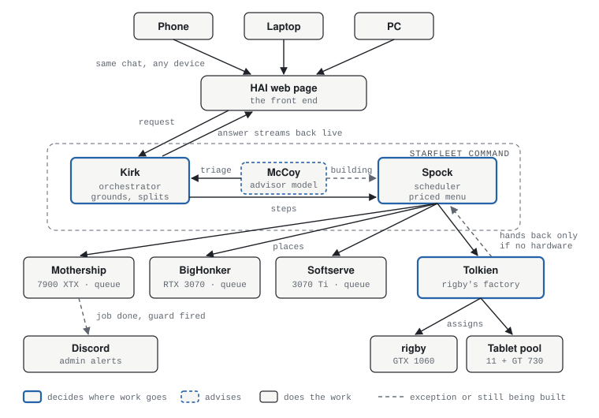
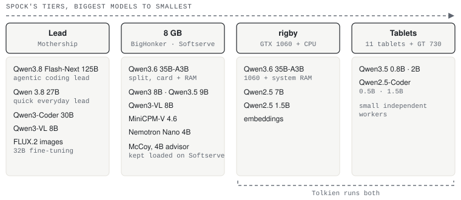
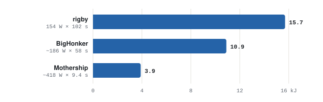

# Home AI without breaking the bank

**A home lab built from everyday PCs and cast-off gear.** None of these machines were purpose built for AI. My gaming PC and a couple of other desktops I've bought over the years, some spare graphics cards, and cast-off gear from yard sales and free bins: an old office PC and eleven Android tablets. Together they run models up to 125 billion parameters, write and test code, and run HAI, my household's assistant, all at home.

*Nick Crowley (DrHawktopus) · numbers as of November 3, 2026 · also at [blog.hawktopus.org/home-ai](https://blog.hawktopus.org/home-ai)*

## Why I built it this way

I'm anti-cloud, and yes, anti Sam Altman. I think people are losing touch with what AI actually takes to run, in power and in the data centers being built for it. If you want to use AI, I think it should run on hardware you own, in your own home.

I'm not a purist about it. I bring in frontier models as hired help for specialist work, and Claude and Codex helped me build this lab. But the AI my household uses every day runs on machines in my house.

The goal has always been simple: take any piece of hardware that comes home, add it to the system, and have the system use it to get more capable. I also want other people to be able to do the same with what they've got. Not everybody has a pile of GPUs.

Owning the machines keeps the cost in front of me: the power draw, the fan noise, the warm room. That's why the results below carry their energy wherever I have it, marked as what the graphics card used or what the whole box drew at the wall.

## The next step: one assistant, any device, every box

Most home AI setups I see are one box running one model behind an agent. Linus is already talking about adding more cards, and Labs runs several rigs. I think the next step is joining them up: one assistant in front, every computer in the house behind it, and each piece of work placed wherever it fits. Models are parts the system uses, picked per request.

The assistant is **HAI**, short for Home AI. Its front door is a web page. Open it on a phone, a laptop or the PC itself and it's the same HAI and the same conversation. The front end and the back end are separate on purpose, so it doesn't matter which device you're holding or which box does the work.

Each person gets their own HAI. Everyone signs in as themselves, and HAI keeps a separate memory and document library for each person, so it learns about you without mixing you up with anyone else. Specialist modes, like a nursing tutor, sit on top without changing whose assistant it is.

Behind the page, HAI is run by a small command crew in two layers. On top is **Starfleet Command**, which decides what each request needs and where it goes:

- **Kirk** — the orchestrator. Takes each request or job, grounds it in the library and, with Spock, breaks it into steps.
- **Spock** — the scheduler. Places each step, weighing speed, energy and quality together.
- **McCoy** — a small advisor model. Today he reads every request for Kirk: how hard it is, what kind of work, chat or job. Advising Spock and Tolkien on placement is the part I'm still building. He proposes; fixed checks decide.

One layer down is **Tolkien**, who does the same job for rigby's factory: the old office PC and the tablet cluster. When Starfleet decides a job is Tolkien-class, it goes to Tolkien, and he decides which card or which tablets do the work. The only time a job goes back up is when the factory doesn't have the hardware it needs; then Tolkien hands it back to be placed somewhere else. Mothership, BigHonker and Softserve each work through their own order queue.

*A request from any device goes through HAI's web page to Kirk, who takes it with McCoy's triage. Spock places each step on a machine's queue, or sends Tolkien-class work to Tolkien, who assigns it inside rigby's factory. The answer streams back to the page as it's written. Blue outlines mark the parts that decide where work goes; dashed lines are the exceptions.*

Spock decides from a **priced menu**: the tested combinations of model, machine and settings, each measured for quality, time and energy per solved task, with the gaps marked. Placement also weighs cold loads, how soon you'll see output, what's already busy and the hour's electricity price. Long jobs like training, renders and benchmarks go in as orders that each machine works through unattended. When a new box comes home, it gets measured and joins the menu.

What lets it run overnight without me is the machinery around those orders. Every machine runs a watchdog on its own card: Mothership's rescues a stalled training run or render, and the 8 GB boxes watch for a lost GPU, frozen telemetry, heat and fans. A patrol on each machine catches AI work running on a card that nothing placed, and either reports it or stops it. The watchdogs restart themselves if they die, and every box pushes its own status to a dashboard, so I can see what each machine is doing from my phone.

Behind the scenes, admin alerts go to Discord: a job finishing, a guard firing, a box that needs a look.

## The front end: one window, live on every device

HAI's web page is the part people actually touch, and I care about it as much as everything behind it.

- **You watch it think.** HAI streams its thinking, its tool calls and its answer as they happen, so a long think never looks like a frozen screen. Open the same chat on a phone and a PC and both show the same live stream.
- **One window, always an agent.** There's no chat mode versus code mode. You just talk, and HAI decides whether to answer, look something up or start a job. Jobs it starts show up as live cards inside the conversation, and long work can run in the background on a time budget.
- **Talk to it while it works.** Send a message in the middle of a job and HAI picks it up at its next step.
- **Auto by default, pins if you want them.** Model and effort are optional. Pick one and it's remembered as a pin that follows your account to any device.
- **It tells you what's going on.** "Waking Mothership", "loading the lead model, about 45 seconds", or your place in the queue with a rough wait and an offer to reroute when the box you pinned is busy.
- **Runs survive restarts.** Every turn and tool step is checkpointed, so a restart or an update parks a run and picks it back up from its last checkpoint. A tool that was cut off mid-step is reported as unknown rather than blindly re-run. You can also branch a conversation from any answer.
- **You choose how much you see:** just the answers, the thinking, or every step.

## What came home, and what it does now

*How Spock sees the machines: four tiers, each holding the models the priced menu has measured there as of November 3, 2026. Spock picks the tier and the row for each request; inside the last two, Tolkien decides.*

Card = energy the graphics card reported. Whole box = at the wall: metered by the box's UPS, or modelled from a line calibrated against that meter. Each figure says which.

### Mothership — my gaming PC

Ryzen 7 5800X · Radeon RX 7900 XTX 24 GB · 64 GB DDR4

The beefiest box in the lab, so it's home to the best-quality models: Qwen 3.8 27B and a 125-billion-parameter mixture-of-experts model (Qwen3.8 Flash-Next, 6B active) both run fastest and best here. The 125B fits on one 24 GB card with the rest held in system RAM, and it's the lead for agentic coding.

| | |
|---|---|
| writing speed | **about 80 tokens/s** for the 125B and **about 69 tokens/s** for Qwen 3.8 27B, median decode across full agentic coding runs |
| agentic coding | **12 of 15 solved**, against 9 for Qwen 3.8 27B. It solved everything the 27B did, plus three more. The 27B still leads the quick everyday work. |
| energy per solved task | 125B: 0.37 MJ card (metered) · about 0.58 MJ whole box (UPS, two tasks modelled). 27B: about 0.70 MJ card · about 0.94 MJ whole box (partly modelled). |

The 15 tasks are Python exercises from the Aider Polyglot benchmark, run through my own agent harness, so this isn't a standard leaderboard score. The 27B's result combines two runs on the same harness. The 125B ran on the Strata engine (0.1.39, ROCm/HIP) with its Q2_0 files, 64 GB of RAM and a 131,072-token window, so a random Q2 file in another engine won't reproduce it. That's one run of the 125B, so the gap is real but preliminary. Both models drew about 515 W at the wall; the bigger model used less energy because it finished sooner.

Also: a 32B FLUX.2 image model fine-tuned (QLoRA) on this one card, native ROCm on Windows — [the recipe is public](https://github.com/drhawktopus/flux2-32b-qlora-rocm-windows).

One catch with heavy AI work on this card: it can silently stop computing while every Windows health check reads normal. The evidence points to two heavy jobs colliding in AMD's on-GPU scheduler (MES). Killing the poisoned job brings the card back in seconds with no reboot, and HAI now spaces out GPU work to avoid the collision. I've filed it upstream ([ROCm/TheRock #6824](https://github.com/ROCm/TheRock/issues/6824)); it isn't a closed case. [The full investigation](https://portfolio.hawktopus.org/amd-gpu-wedge).

### BigHonker — my desktop

i5-9600K · RTX 3070 8 GB · 32 GB DDR4

An 8 GB card is supposed to limit you to what fits in 8 GB. This one runs a 35B mixture-of-experts model split between the card and system RAM, plus everyday chat and vision work. The 35B-A3B on the smaller boxes is one of my favorite results in the lab: a model that size, doing useful work on hardware a lot of people already own.

| | |
|---|---|
| 35B on an 8 GB card | about 6.8 GB of the 18 GB model on the card, the rest in system RAM, at a 65,536-token context |
| vision | Qwen3-VL 8B scored 1.0 on my 24-task image set (216 attempts): about 2 s per task once loaded, about 400 J whole box (modelled) |

### Softserve — the house server

Ryzen 7 5700G · RTX 3070 Ti 8 GB · 48 GB DDR4

Runs the media server, Home Assistant and HAI's front door, hosts McCoy, and lends its GPU when it's free.

| | |
|---|---|
| vision | the same 8B model at 1.0 in 1.35 s once loaded (144 attempts) · a compact model, MiniCPM-V, at 0.97 for about 230 J whole box (modelled) |

### rigby — the old office PC

HP office desktop · i7-3770 (2012) · 24 GB · GTX 1060 6 GB + GT 730 2 GB

A cast-off office desktop with a 2012 i7 and two old graphics cards. It runs Qwen3.6 35B-A3B as a real coding worker, and it's where Tolkien lives.

| | |
|---|---|
| writing speed | **about 18 tokens/s** with the model's own draft head on its current setup, up from 16.7 to 16.9 in mid-October. The 1060 moved to a full x16 slot and the engine was rebuilt in between, so the gain isn't all the slot. |
| reading speed | about 300 tokens/s on the x16 slot, up from about 85 |
| agentic coding, 10 tasks | **6 of 10** on October 15, **5 of 10** on October 26 after the hardware and engine changes, with a different mix of tasks passing |
| power at the wall | about 154 W while working (76 W idle plus 78 W of work), separated out of the UPS it shares with Softserve by regression over four days of ten-second samples |
| energy per solved task | about 0.75 MJ whole box, 0.38 MJ above idle, on the October 26 run (modelled from that wattage and the run time) |

### The Fellowship — the tablet cluster

11 Android tablets · 76 ARM cores · three hardware classes

Tablets on USB networking, running small models as independent workers for captioning, OCR and evaluation sweeps. One is a 32-bit tablet brought back with a custom build of llama.cpp. The GT 730 in rigby works as a twelfth worker in the same pool.

| | |
|---|---|
| model tournament | 13 small models across the three tablet classes: **688 planned cells, 512 ran, 436 passed**. Each cell ran once with a fixed seed, so it ranks models; it doesn't measure run-to-run reliability. [The data is public](https://github.com/drhawktopus/fellowship-gauntlet-results). |

## What didn't work

Negative results count. These saved me from building the wrong thing.

- **Picking the best of several tries needs something that can check the answer.** On six hard tasks on the tablets, a 1.5B coding model went from 0.61 to 0.94 when the hidden tests picked the best of nine tries. That's a ceiling production can't reach, because production has no answer key. Majority voting fell to 0.39. On these tasks, without a checker, more tries didn't help.
- **Spreading one model across the tablets lost.** With a 3B coding model, rigby plus ten tablets working as one machine took about 89 seconds an answer and scored 21 of 30. rigby on its own took about 10 seconds and scored 23 of 30. Similar accuracy, about nine times slower.
- **Helpers don't speed up a single answer.** Ten tablets helping rigby read a 4,000-token prompt raised its prompt-reading speed about 1.3 times over its own best, before the GTX 1060 took that job over. Writing through the same split was 3.6 times slower. Tablets doing their own separate work alongside cost the main model 0 to 2%, and about 6% with the GT 730 serving too.
- **"An 8 GB card can only run what fits in 8 GB" was wrong.** The 35B split across the 3070 and system RAM proved it.

## How local AI numbers lie, and how I check mine

- **"Thinking on" was really medium effort.** For weeks, every "thinking on" Qwen 3.8 result ran at medium, because of how the engine mapped the setting. I proved it from the prompt itself: at xhigh the model received 38 more tokens, the effort sentence. Ollama has since fixed it. The Labs Jarvis article hit the same switch, medium to xhigh.
- **Limits decide scores.** Qwen 3.6 27B scored 0.653 with 27 of 72 answers cut off by a 6,144-token context cap. Given a 65,536-token window, a fixed 10-minute request timeout then cut 7 more. With that timeout removed it solved 71 of 72, and one answer used the whole window.
- **The prompt cache flatters the second run.** Comparing a locked GPU clock against stock, the second arm read 50% faster, because it re-read cached prompts. With fresh long documents, the real difference was 22%.
- **Check what the engine was built with.** One llama.cpp build for Mothership had no SIMD at all on the CPU side, so every measurement taken on it was thrown out. That engine ladder now checks for AVX2 before a run.

## If you've got one gaming PC

You don't need a lab like mine to use any of this. What carries over:

- **Mixture-of-experts models are the big unlock.** Only a few billion parameters are active for each token, so most of the model can sit in system RAM and still run at a usable speed. That's how a 35B runs on an 8 GB card and a 125B on a 24 GB one.
- **Old cards still earn their keep.** A GTX 1060 turned a 2012 office PC into a real coding worker. Give old hardware its own job rather than splitting one answer across it.
- **Measure your own box.** Spec sheets and other people's charts won't tell you what your machine does with your model. A few timed runs will.
- **Check that your settings reach the model.** Effort levels, context size and timeouts have all quietly changed my results. Count how many answers hit a limit before you believe a score.
- **Low watts isn't the same as cheap.** Energy is watts times time. On the same 35B model and the same work tasks, the old office PC used about 15.7 kJ per solve, BigHonker 10.9 and Mothership 3.9. The lowest-watt box was the most expensive per answer.
- **Writing tokens barely cares about power.** On my 3070, a 180 W power limit, down from the stock 280 W, wrote at the same 66 to 67 tokens a second, because writing is limited by memory speed. Reading long prompts is different: in a separate test, slowing the card down halved its draw on long documents and cost about 7% in writing speed, but about 18% in reading speed.

*Whole-box energy per solved task, same Qwen3.6 35B-A3B model and settings, same work tasks. The old office PC draws the least power but takes about ten times as long as Mothership, so each answer costs about four times as much. Counting only the energy above idle: rigby 8.0 kJ, BigHonker 6.8, Mothership 3.0.*

## It runs my house, and it's fun

- **It serves my household.** Everyone gets the same controls, and consent is built in for anything involving a person.
- **It keeps its own library.** Small local models do far better with good documentation, so the lab maintains a knowledge base HAI reads from. It also keeps a rulebook of twenty-one failure classes, each tied to a real incident, so the agents can recognize a mistake before they repeat it.
- **It keeps working on itself, with my approval.** Self-engineering never really ended; a lot of what I build along the way fixes something HAI ran into. HAI takes on real coding work itself: a big job splits into small steps that each have to pass tests, an independent review checks the work, and a job that changed code isn't done until the tests pass on the current code. HAI can propose its own next work but can't put it in its own queue, and nothing reaches production until it passes the full test gate, now over 3,200 tests, and I approve it.
- **It's my playground too.** I learn here and have fun with it: games, image work and plenty of tinkering for its own sake.

## How it was built

I built it with Claude and Codex as hired help: they design, review and fix, and the local lab does the daily work. That's the same rule the lab runs by. Frontier models are contractors brought in for specialty work; the AI you use every day lives on your own hardware.

## More detail

- [portfolio.hawktopus.org](https://portfolio.hawktopus.org) — the lab, project by project
- [The tablet tournament: method and results](https://portfolio.hawktopus.org/gauntlet) · [data](https://github.com/drhawktopus/fellowship-gauntlet-results)
- [32B fine-tune on one 7900 XTX](https://portfolio.hawktopus.org/qlora-32b) · [recipe](https://github.com/drhawktopus/flux2-32b-qlora-rocm-windows)
- [The rulebook the agents work under](https://portfolio.hawktopus.org/doctrine)
- Contact: nickcrowley97@gmail.com
